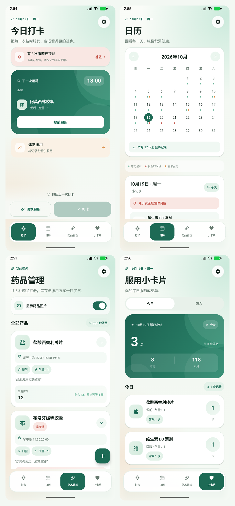

# 药物助手 · Medicine Assistant

一个完全离线的 Android 用药记录与提醒应用。使用 Kotlin + Jetpack Compose + Room 构建，支持中文 / English。

> 当前版本：**v1.2.1**



## v1.2.1 更新

- 修复删除/停用药品后残留闹钟；时间、时区、应用更新后自动重建提醒
- 设置页新增精确提醒权限状态与授权入口
- 通知支持「已服用」和「10 分钟后提醒」快捷操作
- CSV 备份支持多行备注，导入改为事务写入，并保留历史药品名称快照
- 图片保存前自动压缩/纠正方向，删除或替换时清理旧文件
- 药品管理新增搜索
- 升级测试依赖（Espresso 3.7），新增 GitHub Actions CI

## 功能

- 今日打卡：待服、错过、补签、偶尔服药与撤销
- 下一次用药提示、提前服用、打卡庆祝反馈
- 月历视图：服药、偶尔服药、就医提醒时间段
- 药品管理：库存、低库存、剩余天数预测、搜索
- 药品表单：服用方式、频次、时间、库存、预警与备注
- 小卡片：今日 / 药方切换，本周与本月统计
- 本地提醒：服药提醒、错过提醒、就医提醒
- CSV 备份与恢复（支持多行备注、事务导入）
- 中文 / English，数据仅保存在本机

## 构建

环境：JDK 17、Android SDK 36、Android Build Tools 36.1.0。

```bash
./gradlew :app:assembleDebug
./gradlew :app:testDebugUnitTest
./gradlew :app:assembleRelease
```

正式签名配置从根目录的 `keystore.properties` 读取；`.jks`、`keystore.properties` 和 APK 均不会提交到仓库。

## 隐私

- 应用不申请网络权限，不联网
- `allowBackup=false`，用药数据不参与系统备份
- 图片只保存在应用私有目录
- 导出的 CSV 含隐私数据，请妥善保管

## CI

GitHub Actions 会运行单元测试并构建 Debug APK，工作流见 [`.github/workflows/android.yml`](.github/workflows/android.yml)。

## 发布

最新安装包见 [Releases](https://github.com/baiyue23333/Medicine/releases)。
